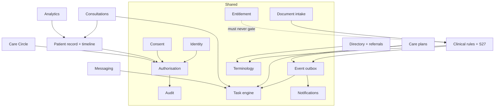

# Tarragon Health 2.0: master architecture, Phase 0 assessment

Date: 2026-11-05. Read against `origin/main-dev` at `441de503c` and the live project `koiplnmbgnqnbywhpjlf`, by four read-only audits (identity and permissions; record, documents, terminology and medicines; tasks, care plans, events and notifications; the patient journey). The security findings in section 10 were each re-checked against the live database by hand.

Source spec (verbatim): `docs/plans/tarragon-2-0-master-architecture-spec-2026-11-05.md`. It sits above the first 2.0 brief (`tarragon-2-0-founder-brief-2026-11-04.md`) and its discovery report (`tarragon-2-0-discovery-2026-11-04.md`, decisions T2-01 to T2-11). Nothing in this document changes code, data or configuration. It answers the spec's Phase 0 and lists its 15 "before implementation" deliverables in order.

Live data is tiny: 8 patient profiles, 8 staff profiles, and almost every workflow table holds only test rows. "Live and verified" below means wired, switched on and checked against the live database, not used by real patients at volume.

---

## 1. Existing architecture assessment (the short answer)

**Most of the spec's shared infrastructure already exists. What is missing is consolidation, not construction.** The platform has a real transactional outbox with idempotent consumers, a proper task engine with leases, tiers and coded outcomes, a single notification sender, one append-only audit log, RLS on all 1,240 public tables, a signed-change gate on care plans, one document intake with 40 document kinds, a CMO-signed screening scheduler and signed interaction rules.

The problem the spec names is real, though: **modules were built one at a time, and many of them grew their own version of a shared service.** There are about 20 task tables, four parallel permission models, about nine consent tables, about 70 module audit tables, lab values stored up to three times, two encounter models, and a timeline that copies rows instead of referencing them. Most cross-module reactions run through about 200 cron sweeps and 192 direct inserts into `notifications` rather than through the outbox.

And at the joins between modules, the journey breaks in four places that matter (section 5).

**Stack.** The spec asks for a modular Django application. There is no Django in this codebase. Stack A (Next.js 16, Supabase Postgres with RLS, edge functions and pg_cron, the stateless Python ML service) is final in `CLAUDE.md`. The spec's actual requirements (clear domain boundaries, service-layer logic, explicit contracts, background jobs, reliable events, idempotent consumers, versioned rules, integration tests, no premature microservices) are all met by the existing stack, and section 12 maps each one to its Stack A equivalent. A rewrite would throw away the safety machinery the spec asks for. This is logged as a conflict, not built.

---

## 2. Module inventory

Statuses use the spec's eight values. Where two apply, both are given.

| # | Spec module | Main objects today | Status |
|---|---|---|---|
| 3.1 | Identity and accounts | `auth.users` + `profiles` (14 roles); supporter = `receives_care=false`, explicit `joinAsPatientToo` onboarding; `patient_duplicate_flags` nightly sweep; `admin_merge_patient_records` | Live and verified (identity, supporter). Duplicate merge: built, never run, no undo or second approver |
| 3.2 | Longitudinal record | `patient_conditions`, `patient_allergies`, `family_history`, `social_history`, `vitals_readings`, three lab stores, imaging/ECG/pathology, `clinical_encounters`, care plans, referrals, `care_messages` | Partially implemented. Clinicians have **no write path to the problem list**; lab values stored up to three times; two encounter models |
| 3.3 | Health assessment | `onboarding_answers`, `risk_assessment_responses`, WHO 2019 instrument; baseline step in #1721 | Partially implemented; In development (#1721). **No doctor review or approval step** |
| 3.4 | Care-plan engine | `care_plans` + 8 child tables, signed `care_plan_changes` gate, `care_tasks` (right shape, 0 rows), screening schedules and signed rule set v4 | Partially implemented. Doctor gate live; approved plan does not become owned tasks |
| 3.5 | Diagnostic directory | `lab_providers` (1 active), 39 locations, `diagnostic_*` listing tables, `directory_enabled` ON | In development (#1710, #1712, #1713, #1715, #1722, #1723, #1726, #1727). Several of their migrations are **live but not merged** |
| 3.6 | Investigation referral | `lab_orders.clinical_indication` (0 of 40 filled), request PDF, `diagnostic_order_suggestions` (0 rows) | Requires integration. **Report not linked back to the request it answers** |
| 3.7 | Document ingestion and AI | CDE `clinical_documents` (one intake, 40 kinds, 8 pipelines), AI-005/006/024 enabled, raw → corrected → confirmed provenance, ClamAV scan (T2-08) | Live and verified (wiring). Scanner: In development (#1719, applied live, unmerged). Requires security remediation (patient can delete source files) |
| 3.8 | Clinical rules and safety | S27 result machine (T2-07 one result engine, live), signed yearly-panel ranges, `triage_rule_sets` BP v8 / glucose v1 / vitals v1 signed, `escalation_slas` | Live and verified. Requires clinical governance: asthma/COPD, heart failure, CKD triage drafts; lab trend rules (#1720); ranges outside the 17-test panel |
| 3.9 | Consultations | `appointments`, Zoom `video_consultations`, availability slots, reminders, AI-017 scribe | Live and verified (booking, pay, call). Requires integration (nothing happens after the call). Requires security remediation (Zoom host link) |
| 3.10 | Medication | one `medications` table split by `source`, `prescriptions`, `/verify-rx`, signed interaction dataset v1 (85 rules), reconciliation and review tables | Built but disabled (`prescribing_enabled` OFF). Gates verified: AI and admin have no write path |
| 3.11 | Messaging and coordination | `care_message_threads` (queue `support`/`clinical`), safety-screen trigger, `needs_doctor` flag, MSG-1 to MSG-5 | Live and verified. No separate clinical-safety queue (screened by trigger instead) |
| 3.12 | Care Circle | `care_circle_members`, `circle_supporter_view`, `circle_supporter_timeline`, `pay_for_care` permission | Live and verified (0 members). Doctor-approved family updates: Not implemented |
| 3.13 | Tarragon Circles | `community_*` tables, separate from the record | Live and verified (empty). Safety hand-off not re-proved in this audit |
| 3.14 | Pharmacy network | `pharmacy_partners` (4, all inactive, none verified), own licence/NAFDAC fields | Built but disabled. No freshness rule for "in stock" |
| 3.15 | Entitlement | `patient_has_feature_access`, `patient_is_member`, `service_products.features`, `go_live_guards` | Live and verified. Overlapping `feature_flags`, `entitlements`, `member_followup_entitlements`. **Free-tier red events: Requires clinical governance** (section 11) |
| 3.16 | Analytics | `analytics` + `analytics_clean` (49 views), 61 definer RPCs all role-checked, test rows excluded | Live and verified (access). Small-cell suppression in only 3 RPCs: Partially implemented |

## 3. Database and model inventory (summary)

1,240 public tables, RLS on every one, 2,011 policies. 154 event types, 22 active event subscribers, about 200 pg_cron jobs, 21 storage buckets (19 private). The shared-service objects that matter for the spec:

| Service | Objects |
|---|---|
| Events | `domain_events` (12,577), `domain_event_deliveries`, `event_subscribers`, `event_types`/`event_type_versions`, `process-events` every 15 s; separate `integration_outbound_events`, `fd_hubspot_outbox` |
| Tasks | `clinical_tasks` + `task_types` (34) + transitions, claims, handbacks, reoffers, watchdog; `clinician_alerts` (separate); about 18 feature task tables (section 4) |
| Notifications | `notifications` (15,292), templates, locales, delivery events, escalation failures; one sender `send-pending-notifications` |
| Audit | `audit_log` (23,852, append-only, 264 actions) + about 70 module logs; `staff_record_opens` (S39c) |
| Consent | `consent_versions`, `patient_consents` (event log) + state/receipt views, consent matrix; about 9 module consent tables |
| Permissions | `private.staff_may_read`, `is_org_staff`, `is_admin`, `has_permission`, `can_read_clinical`, `has_emergency_access`, about 80 other helpers; `profile_access` (+ categories) and `care_circle_members` |
| Terminology | `reference_concepts` + code systems (LOINC 51, ICD-10 13, ATC 23, SNOMED 0, RxNorm 0), 261 synonyms, `units_of_measure` 26, `reference_concept_maps` 0, `lab_tests` 60 |
| Documents | `clinical_documents` intake + per-type stores (`lab_result_documents`, `ecg_report_documents`, `imaging_report_documents`, `patient_documents`, and others) |
| Timeline | `patient_timeline` (3,993, append-only, about 22 source triggers) |

## 4. Duplicate functionality

| Area | What is duplicated | Recommendation |
|---|---|---|
| Tasks | `clinical_tasks`, `clinician_alerts`, `escalations`, `care_tasks`, `care_outreach_tasks`, `alert_follow_up_tasks`, `clinical_follow_ups`, `consultation_follow_ups`, `chronic_programme_coordinator_tasks`, `care_circle_tasks`, `lpe_task_instances`, `mental_health_worklist_actions`, `fd_review_queue`, `ops_desk_assignments`, `directory_reverification_queue`, `risk_reassessment_queue`, `symptom_reviews`, `case_review_actions` (most hold 0 rows) | Make `clinical_tasks` the one engine. New work types become `task_types`, not tables. Retire empty silos by migration; keep `clinician_alerts` as the paging record but give each alert its task |
| Worklists | `clinical_worklist()` (9 kinds, omits tasks, alerts and care tasks) plus 5 other worklist functions | One worklist projection over `clinical_tasks` |
| Lab values | `lab_analyte_readings` → S27 `lab_results`/`lab_result_items` → `screening_results` mirror | S27 is the authority (T2-07). Make the other two read paths or views, in stages |
| Encounters | `clinical_encounters` (synced from 9 sources) and S21 `encounters` (not synced), `video_consultations`, `weight_management_checkins` | Sync S21 encounters and video consultations into `clinical_encounters` |
| Relationships | `profile_access` (+ categories) and `care_circle_members` | Layer explicitly: Care Circle is the patient-facing model; `profile_access` stays for dependants and guardians. One read helper over both |
| Consent | `patient_consents` plus about 9 module consent tables, 5 withdraw functions | One ledger (`patient_consents`) with a `scope` column; module tables become views or are migrated |
| Audit | `audit_log` plus about 70 module logs | Keep module logs where they carry domain detail; require every sensitive action to also write one `audit_log` row through a definer function |
| Entitlement | `feature_flags`, `entitlements` (0 rows), `member_followup_entitlements`, `service_products.features` | `patient_has_feature_access` is the one read; retire `entitlements` if still empty |
| Terminology | analyte vocabulary in TS `ANALYTE_CATALOGUE`, `reference_concepts`, `lab_tests`, `screen_types`, and #1710's investigation catalogue | `reference_concepts` is the one vocabulary; the others key to it |
| Outboxes | `domain_events`, `integration_outbound_events`, `fd_hubspot_outbox` | One outbox (`domain_events`) with an external-delivery subscriber |
| Documents | CDE intake plus per-type stores | Fine as designed (intake header, typed stores); keep `clinical_documents` as the only entry |

## 5. Patient data flow (as built today)

```mermaid
flowchart LR
  REG[Registration + onboarding] --> ASSESS[Risk questionnaire]
  ASSESS -. no doctor approval step .-> PLAN[Care plan]
  ASSESS --> SCHED[Screening scheduler, signed rules v4]
  SCHED --> REQ[Lab order + request PDF]
  PLAN -. approved actions do not become owned tasks .-> TASKS[clinical_tasks]
  REQ --> LAB[Any lab, patient pays]
  LAB --> UP[Upload: clinical_documents intake]
  UP -. report not linked to its request .-> REQ
  UP --> AI[AI-005 extraction, raw / corrected / confirmed]
  AI --> FILE[Clinician files values]
  FILE --> S27[S27 result machine, signed ranges]
  S27 --> CRIT[Critical call: rota, backup, incident]
  S27 --> REL[Release to patient]
  REL --> SCR[screening_results mirror: Cat 2 to 1, alert]
  CONSULT[Zoom consultation] -. no note, no follow-up, no timeline entry .-> TL[patient_timeline]
  S27 -. no timeline trigger .-> TL
  CIRCLE[Care Circle supporter] --> CSV[circle_supporter_view / timeline, permission-filtered]
```

Dotted lines are the integration breaks. In order of harm:
1. **Consultation end.** The first live call (2026-11-03) left no note, no follow-up and no timeline entry. `auto_draft_note_from_video_consultation` returns null silently when it cannot find the clinician, and `video_consultations` has no clinician column.
2. **Request to report.** A returned report cannot be tied to the request it answers, so "track completion" is not possible. 0 of 40 live orders carry a clinical indication (all 40 are patient-initiated).
3. **Assessment to plan.** No doctor approval is recorded on an assessment, and an approved plan does not generate owned tasks.
4. **Results to timeline.** Labs, imaging, ECG, documents, allergies and S21 encounters have no timeline trigger.

## 6. Module dependency map

Rule for every new module: it may depend on Shared; Shared depends on no module. `ENT` never sits in front of `RULES`, `CRIT` or emergency paths (section 11).

## 7. Proposed shared services architecture

No new service is created from nothing. Each spec service names its one owner in the existing schema:

| Spec service | One owner | Work to make it the one |
|---|---|---|
| Identity | `auth.users` + `profiles` | Merge: undo, second approver, per-table rules before first use |
| Authorisation | `private.staff_may_read` (staff), `private.can_read_clinical` (relationships), `has_permission` (actions), tier functions (clinical authority) | Document the four layers as one contract; one relationship read over Care Circle and `profile_access`; MFA (aal2) for staff-only actions |
| Consent | `patient_consents` | Add scope; fold module consent tables in |
| Terminology | `reference_concepts` | Key TS catalogue, `lab_tests`, `screen_types` and #1710 to it; fill `reference_concept_maps`; LOINC for the 8 unmapped analytes (incl. HBsAg and anti-HCV) |
| Workflow and tasks | `clinical_tasks` | Absorb silos as task types; owner roles include patient and family supporter |
| Notifications | `notifications` + `send-pending-notifications` | Route the 192 direct inserts through one function; fix delivery (section 10) |
| Documents | `clinical_documents` | Merge T2-08; remove patient delete on source files; purge files with rows |
| Audit | `audit_log` | Definer-only writes |
| Payment and entitlement | Paystack + `patient_has_feature_access` | Retire overlapping tables |
| Integration | `domain_events` external subscriber, FHIR import (`/api/v1/fhir/import`) | Fold the two side outboxes in |
| Analytics | `analytics_clean` + role-checked definer RPCs | Small-cell suppression as one helper used by every aggregate RPC |

## 8. Event and workflow architecture

The outbox the spec asks for exists: `emit_domain_event` is called inside the producing transaction from 152 functions, events are unique on `(event_type, idempotency_key)`, deliveries on `(event_id, subscriber_key)`, with lease, retry, backoff and dead-letter. Critical paging never depends on a best-effort send: the alert or task row is written in the transaction, and six watchdog sweeps back it up.

What changes:
1. **New cross-module reactions go through the outbox, not a cron sweep or a trigger chain.** Existing sweeps are migrated only when touched.
2. **Spec events map to existing or new event types.** `CarePlanApproved`, `InvestigationRequested`, `ReferralIssued`, `DocumentUploaded`, `ResultVerified`, `CriticalResultDetected`, `DoctorReviewCompleted`, `FollowUpCreated/Completed`, `CareCirclePermissionChanged`, `FamilyUpdateReleased`, `ConsultationCompleted`. Each one gets an `event_types` row and a version before it is emitted.
3. **The care-plan chain** (spec section 5 example) becomes: signed `care_plan_changes` row → `care_plan.approved` event → subscribers create `clinical_tasks` per action (owner role, due, priority, source, authorising clinician), lab orders with the indication, directory suggestions, a patient notification, a Care Circle summary entry filtered by permissions, an analytics count.
4. **The consultation chain:** `consultation.completed` → draft note task for the named clinician (fails loudly if none), follow-up tasks, timeline entry.
5. **Dead deliveries are replayed or closed**, never left: 62 dead `triage.grade_observation` deliveries from 2026-11-03 (test events, function since fixed) are still unreplayed.

## 9. Patient timeline design

Keep `patient_timeline`, but make it a pointer, not a second copy of the facts:
- Each row keeps `source_table`, `source_id`, event time, category and author. Display text is rendered at read time from the source (or the row is refreshed when the source is corrected), so a corrected value never shows its old text.
- Add triggers for every authoritative source with none today: released S27 results, imaging, ECG, pathology, `clinical_documents`, allergies, conditions, S21 encounters, video consultations, medication changes, care-plan approvals, referrals.
- Viewer filtering stays where it is: patient (own), staff (`staff_may_read`), caregiver (`can_read_clinical` by category, sensitive orders excluded), supporter (`circle_supporter_timeline`, consented permissions, 90 days). Nothing is released to a supporter that has not been released to the patient.

## 10. Security and permission findings

Checked live, each needs a fix before the matching module carries real patients:

| # | Finding | Severity | Fix |
|---|---|---|---|
| S1 | **No staff account has MFA.** 0 of 8 staff (2 admin, 3 clinician, 1 finance, 1 analyst) have a verified TOTP factor; MFA is opt-in for every role; no RLS or RPC checks `aal2` | High | Mandatory TOTP for staff roles; `aal2` check on staff-only RPCs and in the console proxy |
| S2 | **Audit rows can be forged.** `audit_log_insert` lets any org staff insert a row naming any `actor_id`; patients can insert self-attributed rows | High | Remove direct insert; writes only through definer functions |
| S3 | **Patient can read the Zoom host start link.** `video_consultations.host_start_url` is selectable by the patient for their own row (column privilege true, RLS allows `patient_id = auth.uid()`). 0 rows hold one today; the next app-scheduled call would expose it | High (latent) | Move the column to a staff-only table (a column revoke does nothing under the table grant) |
| S4 | **Patient can delete the original file of a filed report.** Storage DELETE policies on `lab-result-documents`, `ecg-reports`, `imaging-reports` match by folder only; the DB row survives | Medium | Drop patient delete on these buckets; deletion only through a definer that checks the record state |
| S5 | **5 orphaned clinical files** in storage with no document row (Sept 2026, purge removed rows not files) | Low | Purge files with rows; sweep orphans |
| S6 | **Live migrations with no file on main-dev**: directory P1/P2a/P3 and `t2_08_upload_malware_scan` (PRs #1710, #1712, #1715, #1719 open) | Medium (loss risk) | Merge those PRs promptly, as standing rule says |
| S7 | `joinAsPatientToo` discards its update error, so a failed switch to patient fails silently | Low | Surface the error; Jest test |
| S8 | Notification delivery: last 30 days critical email 63 sent / 744 failed, push 6 / 273; **0 clinician devices page-ready** (stale VAPID) | High for paging | Clinicians re-subscribe; fix missing-email recipients; already tracked in memory |

**Status, 2026-11-05:** S2 is PR #1736 (step 1; step 2 drops direct inserts). S3 is PR #1735. **S1 is deferred by founder decision SEC-01:** mandatory two-step sign-in would be difficult for many Nigerian users, so it is not required for now. The built change (PR #1737, closed unmerged, branch `fix/staff-mfa-required` kept) can be reopened later. MFA stays opt-in, as before. Check the PRs for current state.

The spec refers to a "Tarragon Enterprise Security Architecture specification". It is not in this repository. Until it is supplied, this section is judged against the live rules only.

## 11. Clinical governance requirements

The agent signs nothing. Each item below needs the CMO (or founder) before it is in force:

1. **Free-tier red events (decision needed, conflicts with spec section 9).** A dangerous BP, pulse, SpO2, temperature, symptom, triage or exercise reading on Free raises no clinician alert and no page; the patient gets the emergency safety net and guidance only. This is CMO decision D3/C2 (`20261013004008_two_tier_free_red_event_path.sql`), fails toward paging on error. Abnormal and critical **results** already escalate on every plan (no result function checks membership). The spec says safety must never depend on Membership. Confirm or reverse.
2. Asthma/COPD, heart failure and CKD triage rule sets (draft).
3. Lab trend and deterioration rules (#1720, inert until signed).
4. Ranges and critical limits for any test outside the signed 17-test panel (urine ACR, PSA, thyroid, extra LFTs); until then those go to a doctor unclassified.
5. The missed-follow-up risk model (`risk_models`, draft).
6. Who may author and approve care-plan action templates and conditional rules.
7. The AI action list in spec section 7 is already the platform's rule (AI registry, `runGovernedAi`, no AI write path to medications or plans). Enabling AI-016 imaging extraction, AI-018 and AI-019 each needs its evaluation and human approval.
8. Doctor-approved family updates: what a doctor may release to a supporter, and whether a patient must also agree.

## 12. Migration plan

The spec's Django guidance maps to Stack A like this, so nothing is rewritten:

| Spec asks for | Stack A equivalent (already the pattern) |
|---|---|
| Domain models | Postgres tables per domain, `organisation_id`, RLS |
| Service-layer logic | `private` schema definer functions + `public` RPCs; server actions call RPCs |
| Explicit API contracts | Zod on every route; typed RPC signatures in `database.types.ts` |
| Background jobs | pg_cron + edge functions (Railway for long-running) |
| Reliable events, idempotent consumers | `domain_events` outbox + delivery uniqueness |
| Transactions | one RPC per state change |
| Versioned clinical rules | signed rule-set and config tables, `escalation_slas` |
| Integration tests | `packages/db/tests/` BEGIN/ROLLBACK proofs with sabotage, Jest, `apps/web/e2e-browser` |
| Modular monolith, no microservices | one Next.js app + `apps/console` + ML service, as today |

Consolidation rules for every phase: count rows first (most silos hold 0, so most changes are structural); ship code before schema; never two writers to one store during a move; each move ends with an assertion block; reconcile `seed.sql`; timestamps from the CLI, never hand-typed.

## 13. Integration roadmap

Mapped to the spec's phases and the founder's top-10 priority list. Work already open is not restarted.

| Phase | Content | Depends on |
|---|---|---|
| 0.5 Safety and hygiene (now) | S1 to S8 above; merge the live-but-unmerged PRs | nothing |
| 1 Shared infrastructure | one task engine (fold silos into `task_types`), one worklist projection, consent ledger, relationship read helper, terminology keys + LOINC gaps, notification single entry | 0.5 |
| 2 Unified record | timeline as pointer + missing triggers; S21 encounters and video calls into `clinical_encounters`; clinician problem-list write path; one lab store with read views | 1 |
| 3 Clinical workflow | assessment review step; `care_plan.approved` → owned tasks with conditions; request ↔ report link; consultation completion chain; #1720, #1721 merged | 2, governance items 3 and 6 |
| 4 Patient and family | doctor-approved family updates; supporter participation in calls; clinical-safety message queue if wanted; reminders | 3, governance item 8 |
| 5 Community and network | education links from plans; pharmacy activation with stock freshness rule; other provider types with their own verification | 3 |
| 6 Analytics | one small-cell suppression helper; operational counts from `clinical_tasks` and events | 1 |
| 7 Assurance | the spec's 20-step journey as an E2E suite, Free and Membership; independent pen test; governance review | all |

## 14. Risk register

| Risk | Likelihood | Impact | Mitigation |
|---|---|---|---|
| Staff account taken over (no MFA) | Medium | Very high (PHI) | S1 |
| A critical page is not received (0 page-ready devices, email failures) | High today | Very high | S8; the in-console alarm and named ops call stay the fallback |
| Free-tier red event with no doctor | Low per event | High | Governance item 1 |
| Consolidation breaks a working path | Medium | High | count first, code before schema, proofs with sabotage, one silo at a time |
| Live migrations lost when PRs are closed | Medium | High | S6 |
| Report filed against the wrong patient or request | Medium | High | request ↔ report link, patient match check on upload |
| Spec read as a rewrite (Django) | Medium | High (lost safety work) | section 12 |
| Analytics used to reach records | Low | High | definer RPCs only, role checks, suppression helper |
| Scope: too many phases at once | High | Medium | one phase at a time, each ends with proof |

## 15. Prioritised backlog

1. ~~S1 staff MFA mandatory + aal2 checks.~~ Deferred (SEC-01, 2026-11-05); stays opt-in.
2. **S3 Zoom host link out of the patient's reach.**
3. **S2 audit log definer-only writes.**
4. **S8 paging delivery** (clinicians re-subscribe; recipients without email).
5. **Merge the live-but-unmerged PRs** (#1710, #1712, #1715, #1719) and replay or close the 62 dead deliveries.
6. **Consultation completion chain**: clinician column on `video_consultations`, loud failure, note task, follow-ups, timeline.
7. **Request ↔ report link**: `clinical_documents` / `lab_results` to `lab_orders`; completion tracking.
8. **Governance decision on Free-tier red events.**
9. **One task engine**: fold empty silos into `task_types`; one worklist projection; `care_plan.approved` → owned tasks.
10. **Timeline as pointer** + missing source triggers.
11. **Clinician problem-list write path.**
12. **S4/S5 storage delete and orphan purge.**
13. Assessment review step (with #1721).
14. Consent ledger; relationship read helper.
15. Terminology keys + 8 missing LOINC codes.
16. Doctor-approved family updates.
17. Small-cell suppression helper.
18. Identity merge: undo and second approver before first use.
19. The 20-step journey E2E suite (Free and Membership) as the integration proof.

## Conflicts to log in `docs/OPEN-QUESTIONS.md` (not built past)

- **Django** (spec section 10) vs Stack A final.
- **Free-tier red events** (spec section 9) vs CMO decision D3/C2.
- **Enterprise Security Architecture spec** referenced but not supplied.
- **Three message queues** (support, clinical, clinical-safety) vs today's two queues plus a safety-screen trigger: is the trigger enough?
- **SMS** in spec 4.6 is phone verification only (OQ-05), which matches; WhatsApp stays removed (F-02), which the spec also says.
